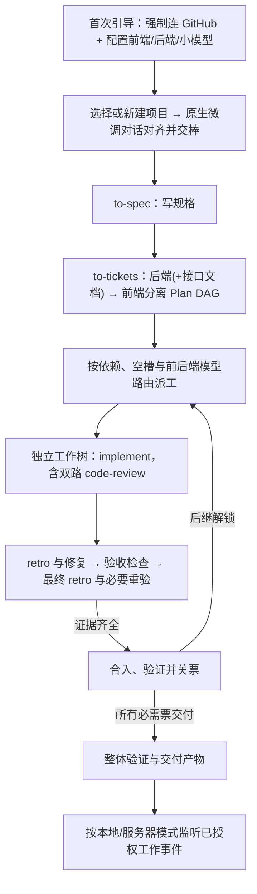

# DeepSeek Harness 全自动研发中枢：架构与工作流规范

本项目的当前设计以 `dsh-superagent-prototype`（DeepSeek Harness + Cordis 插件）为底座，演进为**单插件多项目管理**的 **Hub Agent + Plan DAG + Worker Session（独立 `git worktree`）** 架构。首次使用通过引导完成 GitHub 强制绑定及前后端/小模型配置；大型开发展开为「后端与接口契约先行、前端分离接续」的多节点 Plan DAG，日常单点维护采用单节点计划；支持本地桌面（随窗口启停）与可选服务器 24 小时常驻运行。人类在入口需求对齐后交棒，技术冲突与异常由 Hub Agent 在授权范围内自主处理。产品意图缺失或外部凭据阻塞时请求人类输入；资源额度耗尽时如实暂停受影响工作并报告，不擅自扩大授权。

## 设计要求

- 复用原型的主/执行会话分层、持久化状态与 DSH 原生槽位，不重写或替换 DSH 原生「工作区」组件。无 Bash 与写入权限的中枢（仅保留只读代码/图片检视与协调工具）、多项目隔离、独立 Worktree 执行契约、前后端分离 Plan DAG、分角色模型路由与合入协调是本项目需要落实的目标，不是原型已经提供的保证。原型能力见[底座能力与扩展点摸底](../.scratch/super-agent/issues/01-dsh-prototype-capabilities-audit.md)。
- 原版 Matt Pocock 技能集中包含人工确认卡点的技能（如 `to-spec`、`to-tickets`）必须改造为无人值守自决版本，其中 `to-tickets` 遵循「前后端分离、后端写清接口文档、前端依赖后端契约」的拆票规则；同时支持加载团队/用户自定义 Skills 并按版本锁定。

## 从交棒到持续维护

## 按需读取的规格输入

- **调度与恢复**：[中枢调度契约](../.scratch/super-agent/issues/03-hub-agent-dag-and-context-control.md)定义哪些工作可并行、何时释放后继、异常如何处理，以及中枢如何换新会话而不重复派工。
- **质量与发布**：[工程 Skills 与 CI](../.scratch/super-agent/issues/04-autonomous-skills-testing-and-ci.md)定义双路审查、按影响选测、集成回归和交付证据。首期使用 GitHub Actions；交付产物不等于授权上线。
- **仓库知识**：[文档树协议](../.scratch/super-agent/issues/02-ai-doc-tree-protocol.md)规定 Worker 如何定位最小职责模块、核对改动对文档的影响，以及如何与代码一起合入。术语见[领域词表](../GLOSSARY.md)。
- **可观测性与额度**：[会话计量](../.scratch/super-agent/issues/06-session-metering-capabilities.md)区分当前上下文占用和累计消耗；各 Session、票据和项目共享同一套去重口径。
- **用户入口**：[IM 与面板](../.scratch/super-agent/issues/05-im-channel-and-visual-dag-panel.md)定义 Harness 对话、可选飞书绑定、依赖图、定向暂停和有权限者的 IM 确认卡。
- **空闲期行为**：[可选仓库巡检](../.scratch/super-agent/issues/07-idle-maintenance-scope.md)定义何时允许主动检查，以及检查授权与独立修复计划的边界。未启用巡检不影响正常事件响应和逐票文档维护。
